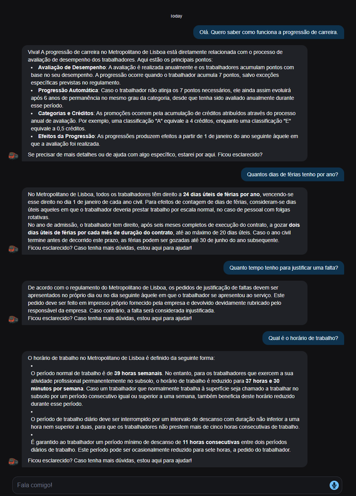

# Conecta — employee onboarding platform

Onboarding portal for **Nortia**, a fictional mid-sized company. New hires read the
mandatory policies, follow their onboarding checklist, find documents and people, and get
help — while HR and IT see who has completed what.

**▶ Live demo: [conecta-ml.pages.dev](https://conecta-ml.pages.dev)**. Use "Ver o portal como"
in the sidebar to switch between employee, manager, HR and IAM admin.

> **Status:** front-end prototype. Being rebuilt into a real application in phases (below).
> All company data, people and policies are fictional.

## Why this exists

Conecta started as my final internship project for my HR degree, at **Metropolitano de
Lisboa** (2025, graded 19/20). In three HR areas I saw how onboarding really works: policies
sent as PDFs, no record of who read what, new hires asking the same questions, and accounts
created by hand. The name "Conecta ML" comes from that project. The company in this
repository is fictional (Nortia): the original brand, internal domains and policies are not
mine to publish, and this is not an official Metropolitano de Lisboa system.

This repository turns that prototype into a working system centred
on what sits behind every onboarding: **identity and access management** — HR as the
source of truth, accounts and access that follow the role, and access that is reviewed
and can be audited.

## Roadmap

| Phase | What works | Status |
|---|---|---|
| 0 | Clean prototype, fictional company, repository | ✅ |
| 1 | **Microsoft Entra ID sign-in (OIDC)** · app roles (employee, manager, HR, IAM admin) decide what each person sees · deployed on Azure with **Bicep + GitHub Actions** (OIDC federated credential, no stored secrets) | ⏳ |
| 2 | **Joiner–mover–leaver automation (Python + Microsoft Graph)**: HR registers a hire → account, manager and birthright groups from the role matrix; mover → old access removed, new access added; leaver → account disabled, sessions revoked, access removed · role matrix as code · append-only audit log | ⏳ |
| 3 | **Access governance**: access requests with manager approval and expiry · separation-of-duties checks · recertification campaigns with evidence export · drift and orphan-account report | ⏳ |
| 4 | **Native Entra features compared with my own build**: Conditional Access, PIM, access reviews and access packages · a SAML app · logs in Log Analytics with KQL · PowerShell admin toolkit | ⏳ |
| Later | AI assistant over company documents that respects each user's access · SCIM provisioning | — |

Full plan, milestones and licensing constraints: [`docs/iam-roadmap.md`](docs/iam-roadmap.md).
Design decisions and their reasons: [`docs/decisions.md`](docs/decisions.md).

## What is in the prototype

Dashboard · onboarding checklist · learning · documents library · org chart · benefits ·
IT support + tickets · feedback. UI in Portuguese (PT).

## The original chatbot (2025)

The internship prototype included **Metrox**, an HR assistant I built on Botpress. Its
knowledge base was a set of public PDF documents on the rights and duties of Metropolitano
de Lisboa workers, and it answered new hires' questions from those documents in Portuguese:
career progression, holidays, absences, working hours.

| Welcome | New hire | Answers from the company rules |
|---|---|---|
|  |  |  |

It is **not embedded in the demo**: it answers with the real company's rules, while the demo
uses the fictional Nortia, and it runs on the Botpress platform rather than in this code
(decision 002). The roadmap's assistant replaces it with one that answers from Nortia's
documents and **respects each user's access**: a new hire cannot get an HR-only document
through the chat.

## Stack

React 18 · TypeScript · Vite · Tailwind CSS · shadcn/ui. Planned: Microsoft Entra ID +
MSAL, Azure Static Web Apps, Azure Functions (Python) with a managed identity, Microsoft
Graph, Azure SQL, Bicep, GitHub Actions, Microsoft Graph PowerShell for admin scripts.

## Run locally

```sh
npm install
npm run dev   # http://localhost:8080
```

`npm run build:demo` builds the public demo: the role switcher stays visible in the sidebar
("Ver o portal como") and a header notice says the company and people are fictional. Until
Entra ID sign-in arrives in phase 1, switching roles is how a visitor sees what each role
(employee, manager, HR, IAM admin) is allowed to use.

## Origin and honesty note

The 2025 prototype UI was generated with Lovable (an AI app builder) from my own design and
content; its HR chatbot, Metrox, is described [above](#the-original-chatbot-2025). The rebuild is done by me with AI-assisted development (Claude Code); every
design decision is written down in `docs/decisions.md` so it can be explained.

— Marco Henriques
